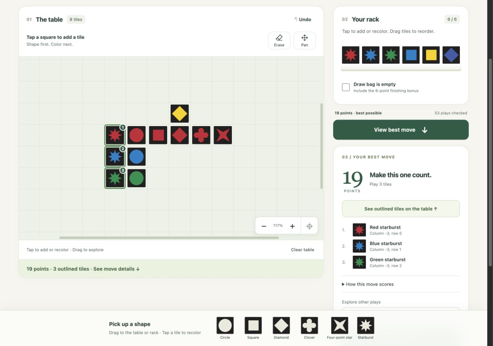
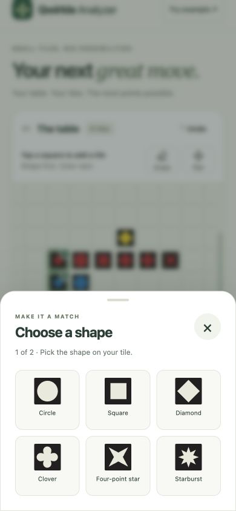
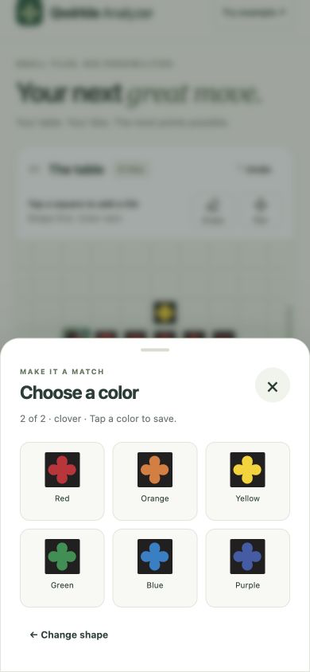
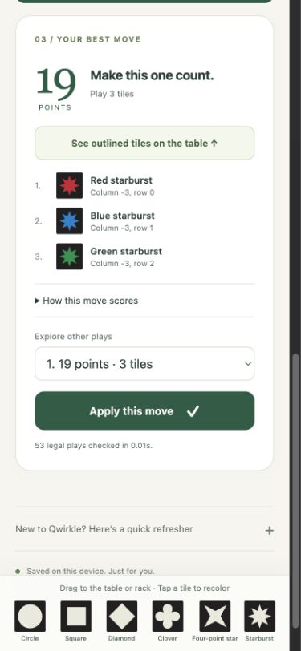

# Qwirkle Analyzer

**Find the highest-scoring move for the tiles you have.** Recreate a Qwirkle table, enter your rack, and explore every legal play in your browser.

[Live demo](https://qwirkle-analyzer.fly.dev) · [Quick start](#quick-start) · [How it works](docs/ARCHITECTURE.md) · [Deployment](DEPLOY.md) · [Contributing](CONTRIBUTING.md)

[](https://github.com/gary-vladimir/Qwirkle-Analyzer/actions/workflows/fly-deploy.yml)



## What it does

- **Exhaustive move search:** evaluates legal placements and ranks them by this turn’s points, including Qwirkle and finishing bonuses.
- **Fast position entry:** tap a square → shape → color, or drag from the permanent six-shape tray onto the table or rack. Tap existing tiles to recolor them.
- **Explainable results:** numbered previews, per-line scoring, tied-best counts, and up to 100 alternative plays.
- **Mobile-friendly controls:** a two-step bottom-sheet picker, a fixed shape tray, draggable rack order, and keyboard alternatives.
- **Browser-local state:** analysis runs in a cancellable Web Worker; the current position is saved in local storage.
- **Minimal stack:** plain HTML, CSS, ES modules, and a small Node.js server. No npm dependencies, accounts, API keys, or frontend build step.

## Mobile UI

Actual screenshots of the running app: choose a shape, choose its color, then review the best move.

<p>
  
  
  
</p>

The built-in example checks **53 legal plays** and finds a **19-point** best move. Search duration varies by device. Screenshot refresh instructions are in [Contributing](CONTRIBUTING.md#updating-screenshots).

## Quick start

Use Node.js **24** to match CI and the container. The package declares Node.js 20 or newer. You also need Git and a modern browser supporting ES modules, module workers, and native dialogs.

```sh
git clone https://github.com/gary-vladimir/Qwirkle-Analyzer.git
cd Qwirkle-Analyzer
npm start
```

Open [localhost:5174](http://127.0.0.1:5174). There is no install or build step. Stop the server with `Ctrl+C`.

The default bind address is `127.0.0.1`. Set `PORT` to use another port; set `HOST` only if you want another bind address. For example, in a POSIX shell:

```sh
PORT=5175 npm start
```

Serve the app over HTTP using the command above; opening `dist/index.html` directly as a file does not provide the module-worker environment the analyzer needs.

## Using the analyzer

1. Select **Try example** for a quick tour, or tap an empty table square, choose one of six shapes, then choose its color. The tile is placed immediately.
2. Add rack tiles the same way. Drag rack tiles to rearrange them. Tap any existing table or rack tile to recolor it, change its shape, or remove it.
3. Check **Draw bag is empty** only when no tiles remain to draw. The 6-point finishing bonus applies only if a move also empties your rack.
4. Select **Find best move**. Use **See outlined tiles on the table** to inspect its placement, **How this move scores** for the breakdown, and **Explore other plays** for alternatives.
5. **Apply this move** updates the table and rack. Enter newly drawn tiles yourself. **Undo** restores the previous edit, including clears, example loads, and applied moves.

| Control | Action |
| --- | --- |
| Tap an empty square or rack slot | Choose a shape, then a color |
| Tap a placed tile | Choose its color; optionally change its shape or remove it |
| Drag a shape from the fixed tray | Place it on a board square or rack slot, replacing an existing tile if occupied |
| Tap a tray shape, then a destination | Place without dragging; choose the color in the popup |
| Drag a rack tile onto another rack slot | Reorder the rack; dropping on an empty slot moves it to the end |
| Alt + Left / Right on a rack tile | Reorder with the keyboard; the tile popup also has Move buttons |
| Drag or swipe the table | Explore the board; Pan mode pauses placement |
| Right-click, Delete, or Backspace | Remove a table tile |
| Arrow keys on a table square | Move keyboard focus through the grid |
| − / + / Fit table to view | Adjust the board view |
| Escape in the tile picker or during a drag | Cancel without changing the position |
| Erase, then tap a table tile | Remove it from the table |

Dragged shapes use the last color chosen in the current session (red initially). Tap the placed tile to select another color. Hover near a board or page edge while dragging to scroll; dropping outside the table or rack cancels. Rack tiles drag within the rack. All edits, including replacements and reordering, support **Undo**.

Positions are saved per browser and origin. Localhost, the public demo, and another device have separate saved positions. Clearing browser storage removes the saved position; undo history lasts only for the current page session. Board and rack data are not uploaded, and the app includes no analytics or external font requests.

## How it works

The engine enumerates horizontal and vertical segments of up to six tiles, tries distinct assignments from your rack, rejects invalid lines and crossings, and scores every affected line once. A module Web Worker keeps this search off the UI thread.

**“Best” means the most points this turn.** The app does not predict future draws or opponents’ moves. On an empty table, it assumes you are the starting player and requires your largest matching set. Read the [architecture and rules documentation](docs/ARCHITECTURE.md) for the algorithm, validation boundaries, data model, and artwork provenance.

## Development and tests

```sh
npm test
```

The suite uses Node’s built-in test runner. It covers position validation, openings, gap filling, crossings, multiple Qwirkles, finishing bonuses, comparisons against an independent brute-force search, rack reordering and saved-position recovery, and the HTTP server’s routes and shutdown behavior.

Edit files in `dist/` directly and reload the browser; this directory contains the application source, not a build artifact. Changes to `server.mjs` require restarting the server. See [Contributing](CONTRIBUTING.md) for the development workflow and UI checks.

## Deployment

The demo runs on Fly.io. Pushes to `main` run tests, deploy the container, and verify `/healthz` through [GitHub Actions](.github/workflows/fly-deploy.yml). Forks need their own Fly app, `FLY_APP_NAME` repository variable, and `FLY_API_TOKEN` repository secret.

See [DEPLOY.md](DEPLOY.md) for setup, token renewal, manual deployment, costs, and troubleshooting. The configuration uses one shared CPU, 256 MB RAM, and automatic stop/start; it does not guarantee free hosting.

## Acknowledgments

Rules follow [MindWare’s official Qwirkle rulebook](https://www.mindware.orientaltrading.com/pdf/instructions/32016.pdf). Tile silhouettes are extracted from the publisher’s tile legend and retain their original proportions. Qwirkle and its artwork belong to their respective owners. This is an independent project, not an official MindWare product.
