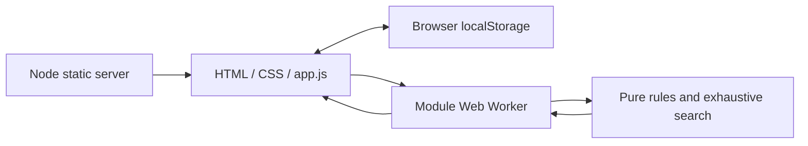

# Architecture and search

[Back to the README](../README.md)

## Runtime boundaries

The browser owns the board, rack, analysis results, and local storage. The Node server only serves an explicit list of static files and `/healthz`; it has no game API or database.

`dist/` is the hand-edited source served directly to the browser, despite its conventional build-output name. There is no bundler or generated application build. Only `tile-art.js` is generated by the optional artwork extraction script.

## Source map

| File | Responsibility |
| --- | --- |
| `dist/index.html` | Semantic page layout and tile-picker dialog |
| `dist/styles.css` | Responsive layout, touch controls, focus and reduced-motion styling |
| `dist/app.js` | Editing, undo history, local persistence, worker lifecycle, move previews |
| `dist/engine.js` | Position validation, scoring, exhaustive move enumeration |
| `dist/worker.js` | Worker message boundary and elapsed search time |
| `dist/tile-art.js` | Shared original tile silhouettes and reference colors |
| `server.mjs` | Static route allowlist, health endpoint, graceful shutdown |
| `test/engine.test.js` | Rules and independent brute-force comparisons |
| `test/server.test.js` | HTTP assets, allowed methods, file restrictions and shutdown |

New browser assets must be added to the allowlist in `server.mjs` and its server test. Repository documentation and screenshots are not served by the app or included in the Docker build context.

## State and worker lifecycle

Board tiles contain `{ x, y, color, shape }`; rack tiles contain `{ color, shape }`. Coordinates are integers. Color and shape IDs are zero-based indexes into `COLORS` and `SHAPES` in `engine.js`; preserve their ordering to keep saved positions compatible.

The local-storage key is `qwirkle-analyzer-v1`, containing `{ board, rack, bagEmpty }`. The UI allows temporarily invalid positions during editing, then validates before searching. Up to 100 undo snapshots are kept in memory for the current page session; undo history and analysis results are not persisted.

Analysis runs in a module Web Worker. Editing the position or cancelling the search terminates the worker and invalidates its preview. Applying a move adds its placements to the board and removes the matching rack tiles. New draws are entered manually.

## Rules and exhaustive search

Based on [MindWare's official Qwirkle rules](https://www.mindware.orientaltrading.com/pdf/instructions/32016.pdf), also checked against the publisher's [travel edition rules](https://www.mindware.orientaltrading.com/pdf/instructions/52132.pdf).

The engine validates connectivity, line attributes, duplicates, the six-tile line limit, and the three-copy inventory limit across the entered board and rack. An incomplete position can be edited freely but must be valid before analysis. This checks the static position, not whether it could have arisen through a particular history of turns.

Every legal turn ends with all its new tiles in one uninterrupted horizontal or vertical line of at most six tiles. At least one new tile touches the old board. The engine enumerates every segment of length 1–6 containing such an empty neighboring square, including segments with existing tiles between newly placed ones. It tries every distinct rack assignment to the segment's empty squares, pruning only invalid lines and perpendicular crossings. Identical rack copies are interchangeable and cannot occur together in a played line. Single-tile plays found along both axes are deduplicated.

Each affected line scores once; a line of six adds a six-point Qwirkle bonus. Emptying the rack with an empty draw bag adds six points. On an empty board, the app assumes you are the starting player and requires the largest matching set. Opening translations and rotations are equivalent, so it uses a canonical horizontal line at the origin while still considering tile order.

The search has no time cutoff or heuristic approximation and runs in a cancellable Web Worker. Scores optimize **this turn's points**, not long-term strategy, future draws, or opponent responses. Equal scores are displayed with more tiles played first, then a deterministic placement order. Tile exchanges score no points and are suggested only when no placement is possible.

## Practical limits

Search time depends on the entered position and the visitor's device. There is no time cutoff; cancellation terminates the worker. Retaining only the top 100 previews limits result display, not the number of legal plays evaluated.

This is a single-turn analyzer, not a complete game manager. It does not track opponents, the contents of the draw bag, historical scores, or future draw probabilities. Static validation cannot prove that a position arose from a legal sequence of turns.

## Tile artwork

`dist/tile-art.js` contains the original vector silhouettes extracted from the tile legend in [MindWare's official rulebook](https://i.mindware.com/match/original/Asset_Type/Document/origFilename/32016/) (PDF title: `Qwirkle_Rules_200401_OL`). The paths are translated to local coordinates without redrawing, rotation, or changing their proportions. Symbol sizes and positions relative to the black tile face are preserved. All app views use this same artwork; existing saved tile IDs remain unchanged.

The six screen colors are sampled from PDFium's RGB rendering of the rulebook's CMYK colors. These match that published reference; physical ink, editions, lighting, and displays can differ. Qwirkle and its original artwork belong to their respective owners. The assets are bundled locally, with no runtime requests to the publisher.

For regeneration only, `scripts/extract-tile-art.py path/to/rulebook.pdf` requires Python with pdfplumber and Pillow. Running the app still requires only Node.js.
